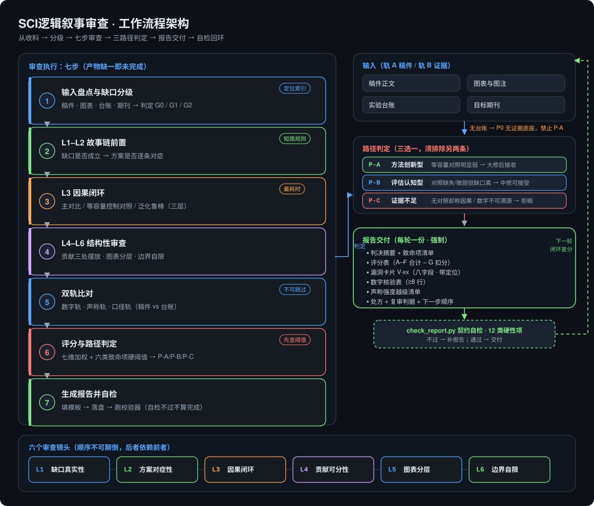
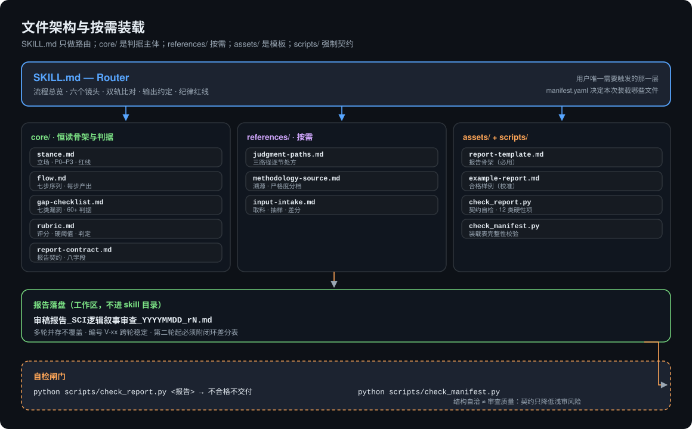

# SCI逻辑叙事审查 · sci-logic-narrative-review

> **很多稿子被拒，不是因为实验不行，是因为叙事链断了——而没人告诉你断在哪一环。**

一个模拟的投稿前同行评审。它不润色、不代写：它沿着整篇稿件的叙事链条逐环审计，把你审稿人迟早会找到的漏洞按结构挖出来，并且**每一轮审查都强制交付一份带证据定位的判决报告**——含可执行修改处方与下一轮的复审判据。

**English: [README.md](README.md)** · **网页首页：https://xionglovetian.github.io/sci-logic-narrative-review/** · **方法论溯源：[docs/METHODOLOGY.md](docs/METHODOLOGY.md)** · **示例报告：[examples/demo-report.md](examples/demo-report.md)**

---

## 为什么需要它

大多数被 desk reject 或大修后仍被退的稿件，并不缺实验。它们缺的是**叙事闭环**：零散的消融与参数试跑被摊成一堆指标，而不是 `发现科学缺口 → 提出对症方案 → 因果验证` 这条链。审稿人读到的是调参报告，于是判定科学贡献弱，建议拒稿。

> 一篇 90 分的稿子，可能被一个缺失的控制组卡死。一句"提升 4%"，可能只是多了 4% 的参数。**你的是哪一种？**

这个 skill 就是为在审稿人之前回答这个问题而设计的。

---

## 选择你的平台

三个版本，**同一份技能目录、同一份报告契约**。用哪个宿主就装哪个——也可以三个都装，它们读同一批文件、互不冲突。

| 你的宿主 | 装到哪 | 详细指南 | 一行安装 |
|---|---|---|---|
| **Claude Code** | `~/.claude/skills/`（或作为插件） | [docs/platforms/claude.md](docs/platforms/claude.md) | `cp -r skills/sci-logic-narrative-review ~/.claude/skills/` |
| **Codex** | `~/.codex/skills/`（或 `[[skills.config]]`） | [docs/platforms/codex.md](docs/platforms/codex.md) | `cp -r skills/sci-logic-narrative-review ~/.codex/skills/` |
| **DeepSeek Harness** | `~/.agents/skills/`（或 `.dsh/skills/`） | [docs/platforms/dsh.md](docs/platforms/dsh.md) | `cp -r skills/sci-logic-narrative-review ~/.agents/skills/` |
| **其它任意 agent** | 直接读 `AGENTS.md` | [AGENTS.md](AGENTS.md) | — |

三端完整差异对照：[PLATFORMS.md](PLATFORMS.md)。

---

## 工作流程架构



*七步执行：收料与分级 → 六个镜头 → 双轨比对 → 三路径判定（P-A / P-B / P-C）→ 强制出报告 → 契约自检 → 下一轮闭环差分。六个镜头按依赖顺序推进：后一个镜头依赖前一个的结论。*

<details>
<summary><strong>文件架构与按需装载</strong>（点击展开）</summary>



`SKILL.md` 只做路由：`core/` 是恒读的骨架与判据，`references/` 按需装载，`assets/` 提供报告骨架，`scripts/` 强制执行契约。报告落到你的工作区，不进 skill 目录。

</details>

---

## 九个优点

### 1. 报告是强制的——"没问题"不被允许

一条不可协商的规则：**没有报告 = 审查没做**。零漏洞被视为不可能；如果真找不到问题，唯一合法解释是输入不全，报告必须明说。"整体质量不错"这类话在契约层面被禁用——你拿到的是判决，不是安慰。

### 2. 每条漏洞都钉在证据上

每张漏洞卡片有八项必填字段：类别、严重度、**定位（章节 + 原文引文）**、证据、*审稿人原话*、为什么有问题、修改处方、复审判据。写不出可定位位置的"感觉不好"不是漏洞，直接删掉，不软化。结果是——一份你能拿去反驳、也能照着改的报告。

### 3. 六个镜头，按依赖顺序过

镜头有先后依赖，后面的结论才不会失焦：

| 镜头 | 审什么 | 抓到的典型症状 |
|---|---|---|
| **L1 缺口真实性** | 引言是否指出一个领域内**默认成立却未被定量质疑**的假设，并说明它造成什么具体偏差 | 开篇直接介绍数据集与模型；缺口写成"现有方法精度不足" |
| **L2 方案对症性** | 每个模块是否对应 L1 的某一条缺陷 | 模块凭空出现；设计动机写成"为了提升性能" |
| **L3 因果闭环** | 三层实验（主对比 / **等容量控制对照** / 泛化鲁棒）是否齐备且有统计检验 | 把增益归因于设计，但参数量同时增加了 |
| **L4 贡献可分性** | 三条贡献是否独立、各有专属实验、在摘要/引言/结论三处摆放一致 | 三条贡献是同一句话换了三种说法 |
| **L5 图表分层** | 机制图在先还是数字堆砌在先；表是否按逻辑分组；显著性标注是否齐 | 一张巨表混装消融、对比与鲁棒性 |
| **L6 边界自限** | 讨论是否写明失效条件、数据范围、与文献的本质区别 | 讨论只复述结果；宣称"通用/普适"却无跨域证据 |

### 4. 双轨比对——声称 vs 实验台账

这是最硬的一项，也是几乎所有写作指南都漏掉的一项。审查以 **轨 A：稿件** 对 **轨 B：实验台账** 并行推进，比三条轨：

- **数字轨**——正文每个数值能否在台账里找到同口径来源（同数据集、同划分、同种子策略、同评价协议）？
- **声称轨**——每个动词的强度是否匹配证据强度？`significantly` 必须有检验；`prove / due to` 必须有等容量对照；`state-of-the-art` 必须是当前且同协议的对比。
- **口径轨**——同一指标在摘要、表、正文、图注里是否同一个值、同一个口径。

**轨 B 缺失时绝不默认"数字大概没问题"**——而是记为 **P0 无证据底座**，并据此压低路径判定。

### 5. 三选一的叙事判定，而不是一个含糊的分数

审查结束必须给出唯一判定，并说明为什么不能走另外两条，以及**升一档的最小成本**：

| 路径 | 触发条件 | 叙事定位 | 可能结局 |
|---|---|---|---|
| **P-A 方法创新型** | 等容量对照明显弱于本方案，且统计显著 | 方法贡献 + 因果闭环 | 大修后接收 |
| **P-B 评估认知型** | 对照缺失或差距微弱，但缺口真实、负向结果扎实 | 严谨的实证评估论文，重心是科学发现 | 中修—小修后接收 |
| **P-C 证据不足** | 无对照却宣称因果、数字不可溯源、隐藏负向结果 | 先补实验，或先撤声称 | 拒稿 |

真实的稿件大多属于 **P-B**。在没有等容量对照的情况下硬撑 P-A，是一篇本可发表的论文被拒的最常见原因。这个 skill 敢把这条路点出来，并给出降级处方。

### 6. 分数不能覆盖硬阈值

七个维度加权满分 100（缺口 20 / 对症 15 / 因果 30 / 贡献 15 / 图表 10 / 边界 10），数字可溯源是**必扣项**而非加分项。然后判定**先查硬阈值**：六类致命项（F1–F6）任一命中，无论总分多高都不能给 P-A。一篇 90 分但缺等容量对照的稿子，是 P-C 稿子——报告会用一句话说清。

### 7. 给的是处方，不是抱怨

每条漏洞都带可执行处方；三条路径各自配逐节改写动作、**能真正改变判定的最小实验集**、以及补完后报告里哪几项会翻转。"建议补充更多实验"被明确禁止——只允许能翻转路径的实验。

### 8. 多轮闭环追踪

漏洞编号（`V-01` …）跨轮稳定。从第二轮起必须附 **闭环差分表**：已修复 / 部分修复 / 未修复 / 申诉成立——并附本稿证据。部分修复必须写明还缺什么。这是唯一能证明"稿子真的变好了"而不是"只是变了"的审计痕迹。

### 9. 契约由代码强制执行

两个零依赖的 Python 校验器，把契约变成机器可查：

```bash
python skills/sci-logic-narrative-review/scripts/check_report.py   examples/demo-report.md
python skills/sci-logic-narrative-review/scripts/check_manifest.py
```

`check_report.py` 校验 12 类硬性项——元信息字段、十一章覆盖、占位符残留、卡片八字段、合法严重度、**至少一条 P1/P2 漏洞**、≥8 行数字核验且结论取值合法、**判定与预估结果自洽（P-C 永远不能配"小修"）**、禁用软化表述、非首轮必须有闭环差分表、边界声明三要素、文件命名规范。自检不过的报告不允许交付。

---

## 与通用"AI 润色"的区别

| | 通用"帮我润色" | SCI逻辑叙事审查 |
|---|---|---|
| 产出 | 改写后的文字 | 判决 + 漏洞 + 处方 + 复审判据 |
| 依据 | 只有稿件 | 稿件 **加** 实验台账（双轨） |
| 缺证据时 | 抹平过去 | 记为 P0，压低判定 |
| 漏洞质量 | "可以更清楚" | 章节 + 引文 + 审稿人原话 + 处方 |
| 零漏洞 | 可能出现 | 被明令视为不可能 |
| 多轮 | 每轮从头开始 | 稳定编号 + 闭环差分 |
| 一致性 | 靠人自觉 | 机器校验契约 |

---

## 不可触碰的底线

这个 skill 拒绝用诚信换录用：

1. 绝不编造实验、对照或结果。
2. 绝不隐藏负向结果——它们是缺口成立的承重证据。
3. 绝不用文字包装替代证据。闭环不了，就**把叙事降级**。
4. 绝不推荐 P-A，如果没有等容量对照。
5. 绝不以"建议润色"结案。

> 降级后的稿子是能过的稿子；靠形容词撑着的稿子是被拒的稿子。

---

## 安装

一份技能目录，四端通用。全部是普通 Markdown，遵循 [Agent Skills 开放标准](https://agentskills.io/)，所以 **Claude Code、Codex、DeepSeek Harness、以及任何读 `SKILL.md` 的 agent 加载的是同一批文件**。差别只在打包方式——完整对照见 [PLATFORMS.md](PLATFORMS.md)。

```bash
git clone https://github.com/xionglovetian/sci-logic-narrative-review.git
cd sci-logic-narrative-review
```

**Claude Code** —— 作为技能直接装（最简单），或作为插件从本仓库市场安装：

```bash
mkdir -p ~/.claude/skills
cp -r skills/sci-logic-narrative-review ~/.claude/skills/
# 或在 Claude Code 里：
#   /plugin marketplace add xionglovetian/sci-logic-narrative-review
#   /plugin install sci-logic-narrative-review@sci-logic-narrative-review-marketplace
```

**Codex** —— 装成独立技能（推荐），或装成插件：

```bash
mkdir -p ~/.codex/skills
cp -r skills/sci-logic-narrative-review ~/.codex/skills/
# 或在 ~/.codex/config.toml 显式登记：
#   [[skills.config]]
#   path = "<绝对路径>/skills/sci-logic-narrative-review/SKILL.md"
#   enabled = true
```

**DeepSeek Harness**：

```bash
mkdir -p ~/.agents/skills
cp -r skills/sci-logic-narrative-review ~/.agents/skills/
```

```powershell
# Windows PowerShell 等价写法（上面任一端通用）
New-Item -ItemType Directory -Force "$env:USERPROFILE\.claude\skills" | Out-Null
Copy-Item -Recurse -Force "skills\sci-logic-narrative-review" "$env:USERPROFILE\.claude\skills\"
```

**其它 agent**：直接让它读 [`AGENTS.md`](AGENTS.md)——六镜头、判定标准、报告契约的单文件摘要。

### 验证打包

```bash
python skills/sci-logic-narrative-review/scripts/check_platforms.py   # Claude / Codex / DSH 三端清单
claude plugin validate . --strict                                     # Claude Code 官方校验器
```

然后直接说：

- 「用 SCI逻辑叙事审查 审一下这篇稿」
- "Review this manuscript before submission — what will the reviewer attack?"

首轮需要：稿件 + 图表图注 + 目标期刊。**提供实验台账才能做完整双轨比对**——没有的话报告会标 `G1 部分`，并禁止判 P-A。

---

## 仓库结构

```
skills/sci-logic-narrative-review/    技能本体（丢进任意 skill 加载器即可）
  SKILL.md                            路由：流程、六镜头、输出契约
  manifest.yaml                       DSH 声明式装载表（其它宿主忽略）
  agents/openai.yaml                  Codex/ChatGPT 的展示名与调用策略（可选）
  core/stance.md                      审稿人立场、P0–P3、红线、自我失败模式
  core/flow.md                        七步执行序列与每步强制产出
  core/gap-checklist.md               七类漏洞、60+ 可判定项、F1–F6 致命项
  core/rubric.md                      加权评分、硬阈值、三路径判定
  core/report-contract.md             报告强制结构与用语禁令
  references/judgment-paths.md        P-A / P-B / P-C 三套逐节改写处方
  references/methodology-source.md    方法论溯源、严格度分档、按类型调权重
  references/input-intake.md          取料、引文抽取、抽样、多轮差分
  assets/report-template.md           报告骨架
  assets/example-report.md            一份填好且通过自检的报告
  scripts/check_report.py             报告契约校验器
  scripts/check_manifest.py           DSH 装载表完整性校验器
  scripts/check_platforms.py          Claude / Codex / DSH 三端清单校验器
examples/demo-report.md               可对外展示的示例报告
docs/METHODOLOGY.md                   框架从哪来、边界在哪
docs/images/                          架构图（SVG + 生成脚本）
index.html                            网页版首页（GitHub Pages 托管）
plugin.json                           Codex / Agent Plugins 清单
.claude-plugin/                       Claude Code 插件与市场清单
.agents/plugins/marketplace.json      Codex 市场目录
AGENTS.md                             通用单文件入口（任意 agent）
PLATFORMS.md                          各平台安装与打包差异
```

## 诚实的边界

- 这是一套**启发式审查框架**，不是任何期刊的官方审稿细则。它预测的是高概率被质疑的结构性问题，不预测录用与否。
- 权重按**实验/应用类**研究校准；理论、纯方法、综述类稿件应调整权重（见 `references/methodology-source.md`）。
- 校验器检查的是**结构与自洽，不是审查质量**。一份技术上通过的报告仍可能是浅审——契约降低了这个风险，但没有消除。
- 它只诊断，不替你写论文。

## 许可

MIT — 见 [LICENSE](LICENSE)。拿去用、拿去 fork、把阈值调得更狠。

## 参与

你的领域总有总被攻击的那一类问题，而清单里没有？把它加进 `core/gap-checklist.md`，带上严重度与复审判据，保持八字段卡片格式不变，并确认 `examples/demo-report.md` 仍能通过 `check_report.py`。见 [CONTRIBUTING.md](CONTRIBUTING.md)。
